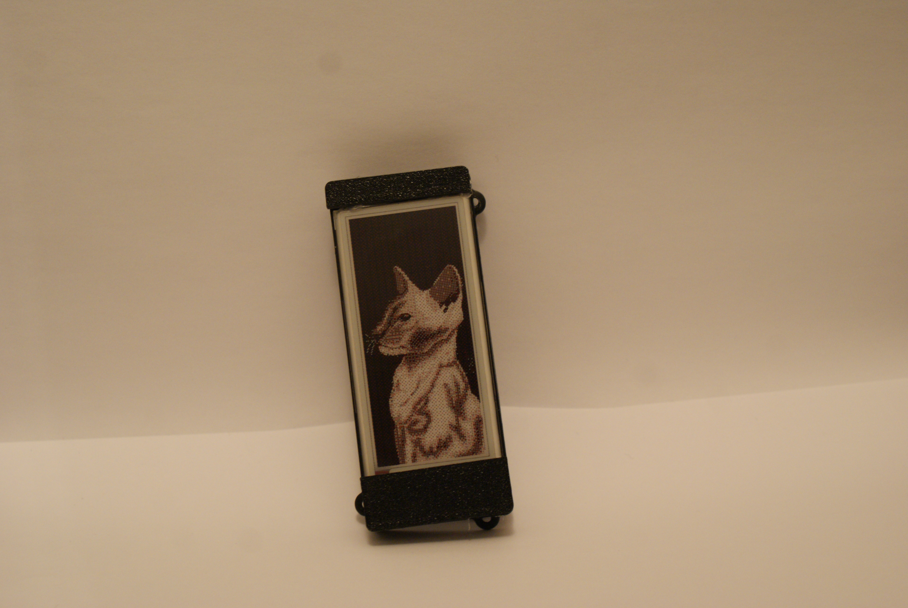
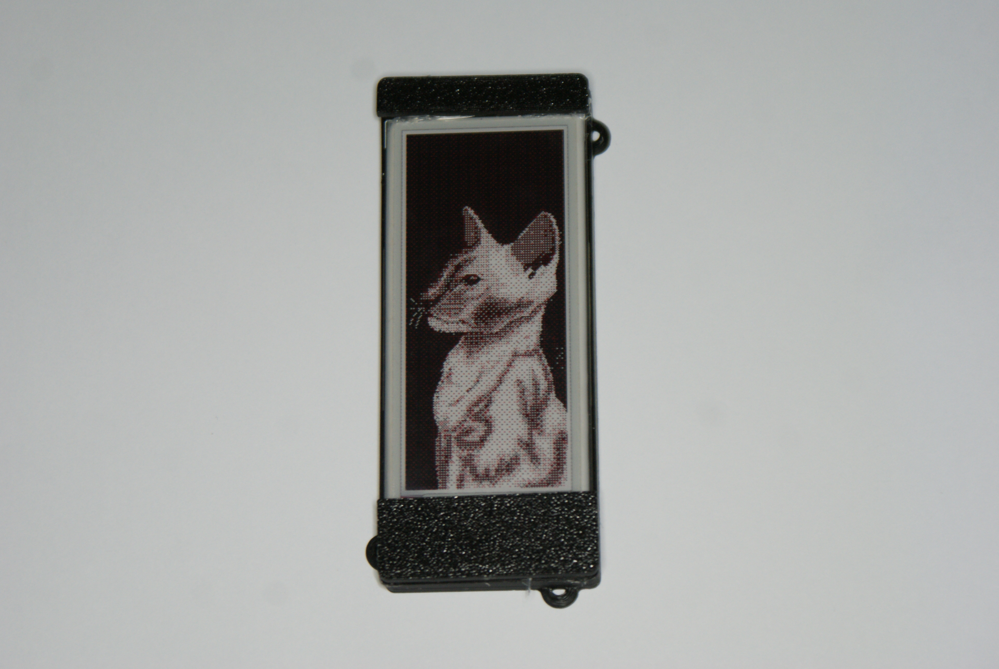
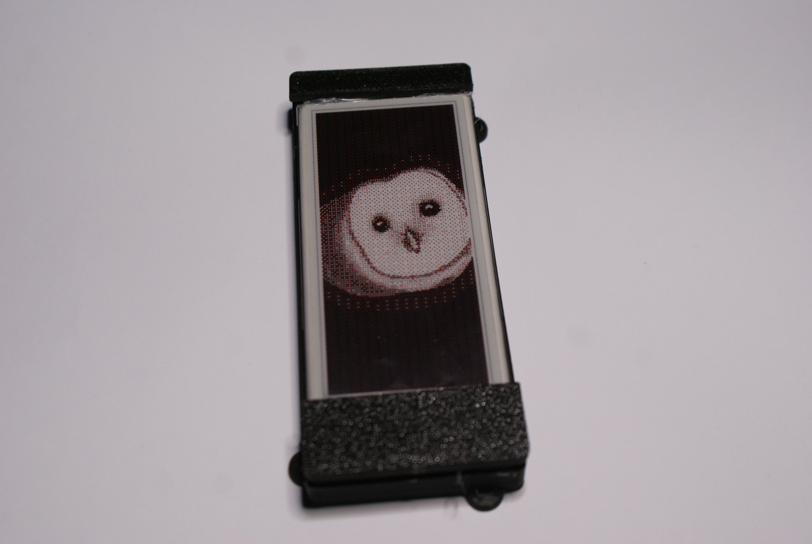
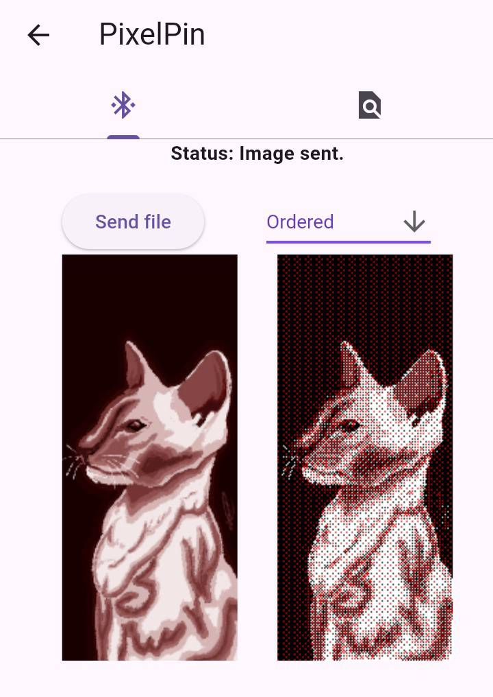

# PixelPin

PixelPin is a wearable Bluetooth e-paper badge. The ESP32 firmware runs a Bluetooth Low Energy GATT server with a custom write-only protocol: a companion Flutter app streams an image as two 1-bit planes (black and red), the firmware assembles them in two framebuffers and drives a 2.9-inch 128×296 black/white/red e-paper panel through GxEPD2. On the ESP32-C3 build the badge deep-sleeps after 5 minutes without BLE traffic and wakes on a button press.

Image conversion (rotate, resize, crop, optional dithering, packing into bit planes) runs in the app, so the badge receives a ready-to-display 9,472-byte image. An earlier version downloaded and decoded PNG/JPEG on the device over Wi-Fi; moving that work to the phone let the firmware drop Wi-Fi and fit the ESP32-C3. The build is written up in [Paged Out! #6](https://pagedout.institute/download/PagedOut_006.pdf#page=31).

This repository contains the ESP32 firmware written in C++. The companion Flutter app lives at [pixelpin-app](https://github.com/mikolajlubiak/pixelpin-app).

## Showcase

<h3 align="center">Device</h3>
<p align="center">
  <a href="docs/epd2.jpg"></a>
  <a href="docs/epd6.jpg"></a>
</p>

<p align="center">
  <a href="docs/epd1.jpg"></a>
  <a href="docs/epd3.jpg"></a>
  <a href="docs/epd4.jpg"></a>
  <a href="docs/epd5.jpg"></a>
  <a href="docs/epd7.jpg"></a>
</p>

<h3 align="center">App</h3>
<p align="center">
  <a href="docs/app1.jpg"></a>
  <a href="docs/app2.jpg"></a>
</p>

## Features

- **Custom BLE protocol:** one write-only GATT characteristic carrying text commands (`BEGIN`, `MONO BUFFER`, `COLOR BUFFER`, `END`, `DRAW`, `CLEAR`) and raw image chunks; each chunk is appended at a tracked offset into the active framebuffer
- **Two 1-bit framebuffers:** 4,736 bytes each for the black and red planes, written to the panel controller in one `writeImage` call and shown with a full refresh
- **Power management (ESP32-C3):** inactivity timer reset on every BLE write; deep sleep after 5 minutes, wake-up on GPIO 3
- **Display abstraction:** a small `draw_*` layer selects the e-paper panel or a 320×240 ST7789 TFT (experimental) at compile time
- **Companion Flutter app** ([pixelpin-app](https://github.com/mikolajlubiak/pixelpin-app)): image selection, rotate/resize/crop to 128×296, optional Floyd–Steinberg, ordered or Riemersma dithering, conversion to black/red bit planes, and a high-priority BLE connection during upload

## Tech Stack

`C++` `ESP32-C3` `ESP32-S3` `Arduino` `BLE` `SPI` `E-Paper` `GxEPD2` `PlatformIO` `Flutter`

## How It Works

```
Phone app (Flutter)                          ESP32 firmware                      E-paper panel
 pick image                                   BLE GATT server                     2.9" 128x296
 rotate / resize / crop  ──BLE writes──►      command parser  ──GxEPD2 / SPI──►   black/white/red
 optional dithering        (512-byte          two 1-bit framebuffers
 black + red bit planes     chunks)           deep sleep after 5 min idle (C3)
```

1. The app converts the selected image into two 1-bit planes (black and red, 128×296, MSB first) and sends them with the [custom BLE protocol](docs/BLE_PROTOCOL.md): `BEGIN`, `MONO BUFFER` + data, `COLOR BUFFER` + data, `END`, `DRAW`.
2. The firmware appends each data chunk to the active framebuffer at its current offset.
3. On `END` it writes both planes to the panel controller's memory through GxEPD2; on `DRAW` it triggers a full refresh.
4. Every BLE write restarts the inactivity timer; after 5 minutes without one, the ESP32-C3 build enters deep sleep until the wake button is pressed.

See [docs/ARCHITECTURE.md](docs/ARCHITECTURE.md) for the firmware structure and [docs/BLE_PROTOCOL.md](docs/BLE_PROTOCOL.md) for the protocol specification.

## Build Instructions

### Prerequisites

- [PlatformIO](https://platformio.org/) (CLI or VS Code extension)
- ESP32-C3 or ESP32-S3 development board
- 2.9-inch 128×296 black/white/red e-paper display supported by GxEPD2's `GxEPD2_290_C90c` driver **or** an ST7789 TFT (320×240, experimental)

### Build and Flash

```bash
# Clone the repository
git clone https://github.com/mikolajlubiak/pixelpin.git
cd pixelpin

# Flash to ESP32-C3 with e-paper display (default)
pio run -e esp32-c3-devkitm-1 --target upload

# Flash to ESP32-S3 with e-paper display
pio run -e esp32-s3-devkitm-1 --target upload

# Monitor serial output (GxEPD2 switches the port to 115200 baud for its diagnostics)
pio device monitor -b 115200
```

### Display Selection

The firmware supports two display backends selected at compile time via build flags in `platformio.ini`:

| Flag    | Display               | Resolution | Colors   |
|---------|-----------------------|------------|----------|
| `-DEPD` | E-Paper (GxEPD2_290_C90c) | 128×296 | Black/White/Red |
| `-DTFT` | TFT LCD (ST7789, experimental) | 320×240 | RGB565 (65K) |

The default build flag is `-DEPD`. To switch to TFT, change `build_flags` in `platformio.ini`.

### Wiring

**E-Paper (ESP32-C3):**

| Display Pin | ESP32-C3 Pin |
|-------------|--------------|
| CS          | SS (GPIO 7)  |
| DC          | GPIO 1       |
| RST         | GPIO 10      |
| BUSY        | GPIO 2       |

**E-Paper (ESP32-S3):**

| Display Pin | ESP32-S3 Pin |
|-------------|--------------|
| CS          | GPIO 10      |
| DC          | GPIO 3       |
| RST         | GPIO 8       |
| BUSY        | GPIO 18      |

**TFT ST7789:**

| Display Pin | ESP32 Pin |
|-------------|-----------|
| CS          | GPIO 10   |
| DC          | GPIO 8    |
| RST         | —         |

The wake-up button connects **GPIO 3** to 3.3 V on ESP32-C3 (wake-up is active high).

## Documentation

- [Architecture Overview](docs/ARCHITECTURE.md)
- [BLE Protocol Specification](docs/BLE_PROTOCOL.md)

## Credits

- [GxEPD2](https://github.com/ZinggJM/GxEPD2) by Jean-Marc Zingg drives the panel.
